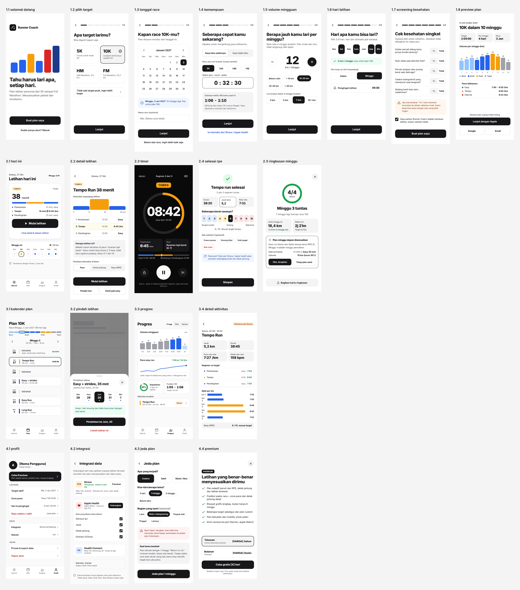

# Wireframes: Run Coach

Status: v0.4 (2026-10-29), memakai design system Lintas (latar abu-abu hangat). Salinan dari artifact wireframe (https://claude.ai/artifact/69xQ9s7SxafNVUKL2vWxka).

- **26 layar HP** (lebar 390) dalam 4 journey. Nomor layar dipakai di semua dokumen `docs/specs/`.
- Warna, tipe dan bentuk sudah memakai Lintas (`source/ds/lintas/`, salinan dari `docs/design-system/`). Layar memakai variabel token (`var(--primary)`), tidak ada hex lepas.
- `overview.png` = semua layar per journey. `png/` = satu file per layar (resolusi 2x).



## Daftar layar

| No | Layar | File | Fitur (PRD) |
|----|-------|------|-------------|
| 1.1 | Selamat datang | [png](png/1-1-selamat-datang.png) | F-01 |
| 1.2 | Pilih target | [png](png/1-2-pilih-target.png) | F-02 |
| 1.3 | Tanggal race | [png](png/1-3-tanggal-race.png) | F-02 |
| 1.4 | Kemampuan saat ini | [png](png/1-4-kemampuan.png) | F-02 |
| 1.5 | Volume mingguan | [png](png/1-5-volume-mingguan.png) | F-02 |
| 1.6 | Hari latihan + pengingat | [png](png/1-6-hari-latihan.png) | F-02, F-12 |
| 1.7 | Screening kesehatan | [png](png/1-7-screening-kesehatan.png) | F-02 |
| 1.8 | Preview plan + buat akun | [png](png/1-8-preview-plan.png) | F-01, F-03 |
| 1.9 | Masuk (akun lama / HP baru) | [png](png/1-9-masuk.png) | F-01, F-18 |
| 2.1 | Hari ini | [png](png/2-1-hari-ini.png) | F-04 |
| 2.2 | Detail latihan | [png](png/2-2-detail-latihan.png) | F-04, F-17 |
| 2.3 | Timer berjalan | [png](png/2-3-timer.png) | F-05 |
| 2.3b | Timer: segmen drill | [png](png/2-3b-timer-drill.png) | F-17 |
| 2.4 | Selesai + RPE | [png](png/2-4-selesai-rpe.png) | F-06 |
| 2.5 | Ringkasan minggu + adaptasi | [png](png/2-5-ringkasan-minggu.png) | F-11 |
| 2.6 | Catat lari manual | [png](png/2-6-catat-lari.png) | F-15 |
| 3.1 | Kalender plan | [png](png/3-1-kalender-plan.png) | F-08 |
| 3.2 | Pindahkan latihan | [png](png/3-2-pindah-latihan.png) | F-08 |
| 3.3 | Progres | [png](png/3-3-progres.png) | F-07 |
| 3.4 | Detail aktivitas | [png](png/3-4-detail-aktivitas.png) | F-14 |
| 4.1 | Profil | [png](png/4-1-profil.png) | F-16 |
| 4.2 | Integrasi data | [png](png/4-2-integrasi.png) | Fase 2 |
| 4.3 | Jeda plan | [png](png/4-3-jeda-plan.png) | F-09 |
| 4.4 | Premium | [png](png/4-4-premium.png) | F-23 (fase 2, lihat di bawah) |
| 4.5 | Data & privasi | [png](png/4-5-data-privasi.png) | F-13, F-18, F-19 |
| 4.6 | Hapus akun | [png](png/4-6-hapus-akun.png) | F-10 |

## Fase 2 (v0.5, 2026-10-30)

Dibuat dengan `phase2.py` (satu sumber, keluaran Bahasa Indonesia dan English), sumber `source/P2-*.dc.html` dan `source/P2-*.en.dc.html`, dirender dengan `render.js` (perintah di kepala `phase2.py`). Animasi gerakan sengaja **kosong** (kotak putus-putus "Animasi gerakan menyusul", D8).

| No | Layar | ID | EN | Fitur |
|----|-------|----|----|-------|
| 2.1s | Hari ini + kartu strength, tanda S di lajur minggu | [png](png/2-1s-hari-ini-strength.png) | [png](png/2-1s-hari-ini-strength-en.png) | F-21 |
| 2.2s | Detail strength (daftar gerakan + tempat animasi) | [png](png/2-2s-detail-strength.png) | [png](png/2-2s-detail-strength-en.png) | F-21 |
| 2.3s | Timer mode gerakan | [png](png/2-3s-timer-gerakan.png) | [png](png/2-3s-timer-gerakan-en.png) | F-21 |
| 2.3s | Timer istirahat antar set | [png](png/2-3s-timer-istirahat.png) | [png](png/2-3s-timer-istirahat-en.png) | F-21 |
| 2.4s | Selesai strength + "Bebannya terasa" | [png](png/2-4s-selesai-strength.png) | [png](png/2-4s-selesai-strength-en.png) | F-21 |
| 4.1 | Profil fase 2 (sakelar strength, Bahasa, baris Premium saat paywall aktif) | [png](png/4-1-profil-fase2.png) | [png](png/4-1-profil-fase2-en.png) | F-21, F-22, F-23 |
| 4.4 | Premium (menggantikan 4.4 lama; pembelian nonaktif di fase 2) | [png](png/4-4-premium.png) | [png](png/4-4-premium-en.png) | F-23 |
| 4.8 | Bahasa | [png](png/4-8-bahasa.png) | [png](png/4-8-bahasa-en.png) | F-22 |

## Yang berubah di v0.4

| Perubahan | Layar |
|-----------|-------|
| Latar krem diganti abu-abu hangat `#F5F4F2` (+ `surface-sunken` `#EAE8E5`, `line` `#DDDAD6`); `primary-ink`, `accent-ink`, `success` sedikit digelapkan agar kontras tetap >= 4.5:1 | Semua |
| Kartu "Kenapa plan ini?" (alasan + label tingkat bukti + Lihat sumber, spec 07). Contoh grafik volume patuh TRD 4.2: naik maks 10%, cutback minggu 4 dan 8, taper 10K 1 minggu turun 50% | 1.8 |

## Yang berubah di v0.3

| Perubahan | Layar |
|-----------|-------|
| Re-skin penuh ke Lintas: krem + oranye, bib tipe latihan, lintasan oval (timer, kepatuhan, ringkasan minggu), lajur minggu, ikon dan logo baru | Semua |
| Model privasi "data di HP": catatan di 1.1 dan 1.8, layar 1.9, 4.5, 4.6; jawaban kesehatan dan bagian nyeri ditandai tidak disimpan | 1.1, 1.7, 1.8, 1.9, 4.2, 4.3, 4.5, 4.6 |
| Latihan contoh hari ini memakai drill ABC (F-17): 10 + 8 + 14 + 10 = 42 menit | 2.1, 2.2, 2.3, 2.3b, 2.4, 3.1 |
| Layar yang dulu belum ada (O1, O4): log manual, login email, hapus akun, segmen drill | 1.9, 2.3b, 2.6, 4.6 |
| Status sinkron Strava di 2.1 diganti tautan "Catat lari manual" | 2.1 |

## Catatan membaca gambar

- Setiap layar digambar di **state awalnya** (contoh: timer berjalan, RPE 6 terpilih, alasan jeda "Cedera").
- Di artifact, setiap layar dipotong di tinggi 844 px. Di sini layar dibiarkan setinggi isinya; layar yang lebih tinggi berarti bisa di-scroll di app.
- Angka di layar (pace, jarak, tanggal) adalah contoh tampilan, bukan data atau hasil engine. Teks dalam kurung siku (`[HARGA]`, `[email]`) adalah placeholder.
- Layar fase 2/3 (4.2, 4.4, tautan Strava di 1.4 dan 2.4) tetap digambar untuk arah produk, tapi disembunyikan di MVP (PRD bagian 5).

## Isi folder

| Path | Isi |
|------|-----|
| `overview.png` | Semua layar per journey |
| `png/` | 1 PNG per layar, lebar 780 px (2x) |
| `source/*.dc.html` + `canvas.json` | Sumber tiap layar + susunan canvas dan catatan journey. Butuh runtime artifact untuk tampil interaktif |
| `source/ds/lintas/` | Salinan Lintas untuk canvas: `tokens.css` (dibuat dari `tokens.json`), `tokens.json`, `components/bundle.css` |
| `render.js` | Script ekspor `source/` ke PNG |

## Ekspor ulang

Butuh Node.js, Playwright + Chromium, dan font **Bricolage Grotesque** + **Plus Jakarta Sans** terpasang di sistem (Google Fonts, lisensi OFL). Script tidak memuat apa pun dari internet; stylesheet di `source/ds/` di-inline dari disk.

```bash
node docs/wireframes/render.js docs/wireframes/source docs/wireframes/png \
  Main.dc.html=1-1-selamat-datang.png Today.dc.html=2-1-hari-ini.png
# tambahkan pasangan <file sumber>=<nama png> untuk layar lain, sesuai tabel di atas
```

`render.js` meniru sebagian kecil runtime artifact: `{{nilai}}`, `<sc-for>`, `<sc-if>`, state awal, dan stylesheet `ds/`. Jika wireframe mulai memakai fitur lain (misalnya `<dc-import>`), script perlu ditambah.

Jika token di `docs/design-system/tokens.json` berubah: perbarui artifact Lintas, buat ulang `source/ds/lintas/tokens.css`, lalu ekspor ulang PNG.
