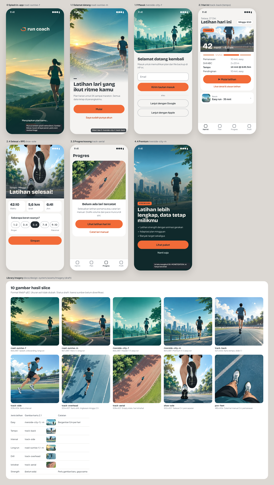

# Eksplorasi imagery (draft)

Bukan bagian dari wireframe resmi v0.6; nomor layar mengikuti `docs/wireframes/README.md`. Gambar dari `docs/design-system/assets/imagery/` (lihat README di sana untuk status lisensi dan resolusi).

Render ulang: `node docs/wireframes/explorations/imagery/render.js` (memakai Chromium bawaan `/opt/pw-browsers/chromium`).

| Layar | Gambar | File |
|---|---|---|
| 0 Splash in-app (setelah splash native ikon) | road-sunrise-f | [png](png/0-splash.png) |
| 1.1 Selamat datang (hero setengah atas, memudar ke `bg`) | road-sunrise-m | [png](png/1-1-selamat-datang.png) |
| 1.9 Masuk (header bergambar) | riverside-city-f | [png](png/1-9-masuk.png) |
| 2.1 Hari ini (latar kartu per jenis latihan + kartu "Besok") | track-back, riverside-city-m | [png](png/2-1-hari-ini.png) |
| 2.4 Selesai + RPE | shoe-sole | [png](png/2-4-selesai.png) |
| 3.3 Progres kosong (empty state) | track-aerial | [png](png/3-3-progres-kosong.png) |
| 4.4 Premium | riverside-city-m | [png](png/4-4-premium.png) |
| Library + pemetaan jenis latihan ke gambar | semua | [png](png/library.png) |
